# Target-State Architecture

The diagrams are the **target state**, not only the demo. What was built and verified live is in [`README.md`](README.md) ("Demo", "Known limitations").

| View | Source | Image |
|---|---|---|
| Overview (one screen) | [`diagrams/architecture-overview.mmd`](diagrams/architecture-overview.mmd) | [`.svg`](diagrams/architecture-overview.svg) |
| Detailed (six teams, agentic/MCP path, built/target legend) | [`diagrams/architecture.mmd`](diagrams/architecture.mmd) | [`.svg`](diagrams/architecture.svg) |

## Overview

It shows the gateway, both providers (Bedrock Frankfurt and the External LLM Provider under ZDR), Langfuse traces vs. Datadog derived metrics, the audit path, and where the Terraform modules sit (control plane only, not in the request path).

Built today: the gateway, Bedrock, Langfuse Cloud traces, the Postgres request log, and the AWS Budget alarm (two use cases: AdvisorChat and DigestBot). Target state only (dashed in the diagrams): the External LLM Provider at runtime (catalogued, but not in the gateway `model_list` and no secret for its key), Datadog derived metrics, monitors, notifications and paging, the durable audit store, the tool/MCP broker, self-hosted Langfuse, the Bedrock VPC endpoint (PrivateLink) with an internal ALB and fixed-IP egress for the external provider, SSO for employees (IdP group to team), and AdvisorChat's gateway key read only by its own task role.

AWS services have an orange border and their AWS icon. Non-AWS parts are grey boxes.

## Tool responsibilities

Each capability has one owner: LiteLLM enforces and meters, Langfuse explains LLM behaviour, Datadog monitors platform health. See [`design.md`](design.md) §5.

## Detailed view

The full diagram, with all six teams, the agentic/MCP tool path and the built/target legend, is [`diagrams/architecture.svg`](diagrams/architecture.svg).

Icons are in [`diagrams/icons/`](diagrams/icons/): Iconify `logos` (CC0-1.0) and the Bedrock icon from theSVG (MIT), recoloured. Marks belong to their owners.
