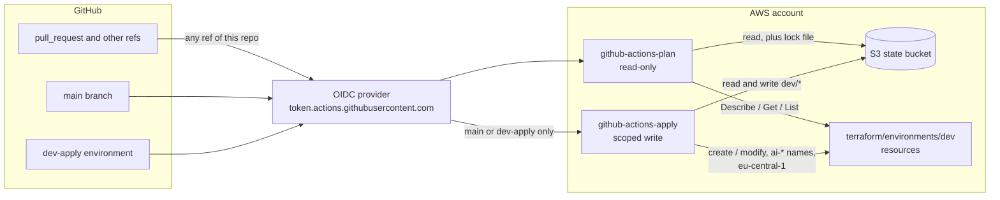

# `terraform/bootstrap`

One-time setup that lets GitHub Actions run Terraform against this AWS account **without long-lived keys**. It creates the GitHub OIDC identity provider and two IAM roles, one for `plan` and one for `apply`.

It is a separate root from `terraform/environments/dev` on purpose. The pipeline cannot create the roles it authenticates with, so you apply this root **once, locally**. It also has its own state key (`bootstrap/github-oidc.tfstate`), so its lifecycle is independent of the environment it grants access to.

## How CI gets AWS access

A job requests a GitHub OIDC token, AWS STS checks its audience and subject against the role's trust policy, and returns credentials that last at most one hour.

## What it creates



| File | Contents |
|---|---|
| `oidc.tf` | The GitHub OIDC provider, or a lookup of an existing one (`create_oidc_provider`). An account can hold only one per issuer URL |
| `plan_role.tf` | `github-actions-plan`: read-only, for the `plan` job in `terraform.yml` and for `drift-detection.yml` |
| `apply_role.tf` | `github-actions-apply`: write access for `terraform-apply.yml` |
| `backend.tf` | S3 backend, same bucket as `dev`, key `bootstrap/github-oidc.tfstate` |
| `variables.tf` | `github_sub_prefix`, `state_bucket`, `create_oidc_provider` |
| `docs_site.tf` | Private S3 bucket and CloudFront distribution (OAC) hosting the docs site |
| `docs_publish_role.tf` | `github-actions-docs`: publishes the docs site, `main` only |
| `outputs.tf` | Role ARNs, the provider ARN and the docs site outputs |

## The two roles

| | `github-actions-plan` | `github-actions-apply` |
|---|---|---|
| Used by | `plan` job, drift detection | `terraform-apply.yml` |
| Trusted from | any ref of this repo (`sub` = `<prefix>:*`) | `refs/heads/main` or the `dev-apply` environment |
| Can do | `Describe`/`Get`/`List` on the services `dev` manages, read `ai-*` secret values (needed to refresh write-only secret versions), read `dev/*` state, create and delete the `.tflock` lock file | everything the plan role can, plus create and change ECS, RDS, ALB, the gateway WAF and ALB-log bucket, security groups, log groups, alarms, budgets, SNS, ACM, `ai-*` secrets and `ai-*` roles, and write `dev/*` state |
| Guardrails | read-only apart from the lock file | write actions limited to `eu-central-1` (and `us-east-1` for the global budgets and quotas endpoints), secrets and roles limited to `ai-*` names, only the ECS execution policy may be attached, no access to `github-actions-*` or the OIDC provider, so it cannot change its own permissions |

Both sessions last at most one hour.

The trust policies pin the audience to `sts.amazonaws.com` and the subject to this repo's immutable claim (`github_sub_prefix` embeds the owner and repo IDs, not just the names), so a renamed or recreated repository does not inherit access.

## Apply it

Prerequisites: the state bucket already exists, and you have local AWS credentials for the account. Replace the placeholder bucket name (`ai-gateway-tfstate-123456789012`) in both `backend.tf` files and in `state_bucket` with your own, and set `github_sub_prefix` for your fork.

```bash
source .env.aws
terraform -chdir=terraform/bootstrap init
export TF_VAR_github_sub_prefix="repo:<owner>/<repo>"   # or the immutable-claim form, see variables.tf
terraform -chdir=terraform/bootstrap apply
gh secret set AWS_PLAN_ROLE_ARN  --body "$(terraform -chdir=terraform/bootstrap output -raw plan_role_arn)"
gh secret set AWS_APPLY_ROLE_ARN --body "$(terraform -chdir=terraform/bootstrap output -raw apply_role_arn)"
```

The workflows then pass the role ARNs to `aws-actions/configure-aws-credentials`. See `docs/ci.md` for the workflows themselves.

If the account already has a GitHub OIDC provider, apply with `-var create_oidc_provider=false`.

## Docs site

The Antora documentation site (`asci-doc/README.md`) is hosted here rather than in `terraform/environments/dev`, because it is not part of the AI platform and its publish role must exist before any workflow can use it.

| Resource | Notes |
|---|---|
| S3 bucket `ai-gw-docs-site-<account id>` | Private: all public access blocked, SSE-S3, `BucketOwnerEnforced`. Only CloudFront can read it. |
| CloudFront distribution | Origin access control, default `*.cloudfront.net` certificate, `PriceClass_100`, HTTPS redirect, managed caching and security-headers policies. Missing pages return the site's `404.html` with status 404. |
| Role `github-actions-docs` | Trusted for `refs/heads/main` only. Can `ListBucket` and read, write and delete objects on the docs bucket, and `CreateInvalidation` on the distribution. Nothing else. |

The whole site sits behind HTTP basic auth, enforced by a CloudFront viewer-request function (`functions/docs-basic-auth.js`). Only the password's SHA-256 is stored, in the function code and Terraform state; the password never enters Terraform. It is one shared credential, so there is no per-person audit trail and rotating it means applying again.

Create the credential and apply (keep the password in your password manager; the default user is `docs`):

```bash
pw=$(openssl rand -base64 18); echo "$pw"
export TF_VAR_docs_basic_auth_password_sha256=$(printf %s "$pw" | shasum -a 256 | cut -d' ' -f1)
```

Apply locally (as above), then record the settings the publish workflow needs:

```bash
gh secret set AWS_DOCS_ROLE_ARN --body "$(terraform -chdir=terraform/bootstrap output -raw docs_publish_role_arn)"
gh variable set DOCS_BUCKET --body "$(terraform -chdir=terraform/bootstrap output -raw docs_bucket_name)"
gh variable set DOCS_DISTRIBUTION_ID --body "$(terraform -chdir=terraform/bootstrap output -raw docs_distribution_id)"
gh variable set DOCS_SITE_URL --body "$(terraform -chdir=terraform/bootstrap output -raw docs_site_url)"
```

Then run the `docs-publish.yml` workflow from `main` (`docs/ci.md`). Until something is published, the CloudFront URL returns 403 or the 404 page.

## Known gaps

- The plan role's trust covers every ref, and it can read `ai-*` secret values. Anyone who can push a branch can run a workflow that reads them. This is fine for a private repo with trusted collaborators, not for production.
- The apply role can still be assumed from plain `main`, not only through the `dev-apply` environment. Required reviewers on that environment are not available on this repo's plan (`docs/ci.md`).
- The apply role can write inline policies on `ai-*` roles it creates, without a permissions boundary.
