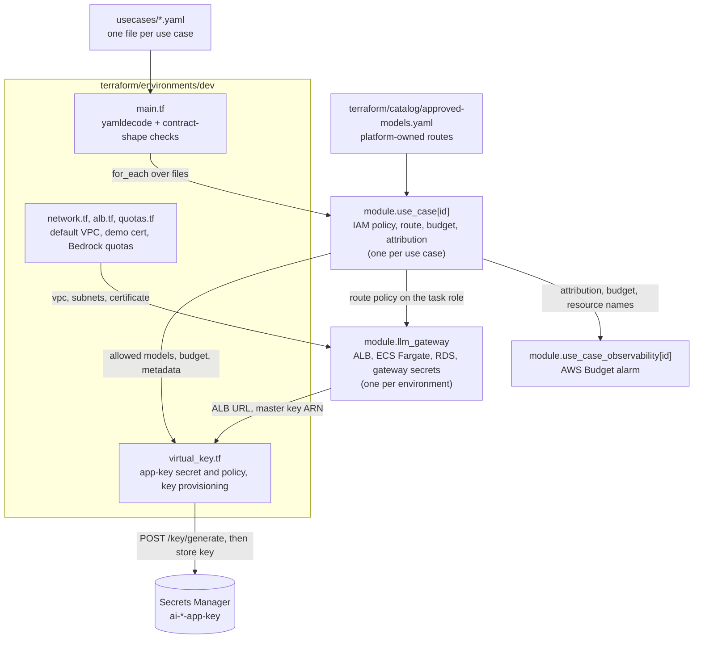

# `terraform/environments/dev`

The deployable root for the dev/demo environment. It is **wiring only**: it reads the product teams' declarations from `usecases/*.yaml`, hands them to the platform modules, and adds the few things that exist once per environment (networking lookup, demo certificate, service quotas, per-use-case virtual keys). It contains no reusable logic.

## What it wires together



Onboarding a use case is a YAML-only change: add `usecases/<id>.yaml`, and `for_each` creates its module instance, observability, secret and virtual key.

## Files

| File | Contents |
|---|---|
| `main.tf`, `locals.tf` | Instantiates the modules per `usecases/*.yaml`, checks the contract shape and id uniqueness |
| `virtual_key.tf`, `terraform/environments/dev/scripts/ensure_virtual_key.sh` | Per use case: the app-key secret and its reader-only policy, and an idempotent script that creates or syncs the LiteLLM key and stores it |
| `network.tf`, `alb.tf`, `quotas.tf` | Default VPC (no NAT), demo self-signed certificate, Bedrock quota requests |
| `providers.tf`, `versions.tf`, `backend.tf` | AWS provider (`eu-central-1`), Terraform `>= 1.11.0`, S3 state with `use_lockfile` |
| `variables.tf`, `outputs.tf` | CI role ARNs, operator ARNs, Langfuse keys and host; module outputs and URLs |

## Inputs

| Variable | Notes |
|---|---|
| `langfuse_public_key`, `langfuse_secret_key` | Required, **ephemeral**: never written to state or a saved plan. Stored in Secrets Manager with write-only attributes and injected into the ECS task |
| `langfuse_host` | Required. Validated to be the Langfuse Cloud **EU** host, so trace data stays in the EU |
| `ci_plan_role_arn`, `ci_apply_role_arn` | Optional. The CI roles from `terraform/bootstrap`, added to the gateway key secrets' resource policies |
| `local_operator_arns` | Optional. Extra stable principals allowed to read the gateway and app-key secrets |


## Run it

```bash
source .env.aws
source .env.langfuse
export TF_VAR_langfuse_public_key="$LANGFUSE_PUBLIC_KEY"
export TF_VAR_langfuse_secret_key="$LANGFUSE_SECRET_KEY"
export TF_VAR_langfuse_host="$LANGFUSE_HOST"

terraform -chdir=terraform/environments/dev init
terraform -chdir=terraform/environments/dev validate
terraform -chdir=terraform/environments/dev plan
```

In CI the same steps run through `.github/workflows/terraform.yml` (plan on PRs) and `terraform-apply.yml` (apply after merge). See `docs/ci.md`. Apply the CI roles first, once, from `terraform/bootstrap`.

## Things to know

- **The virtual key is created at apply time by a script**, not by a Terraform resource, because LiteLLM's keys live in its own database. `terraform_data.virtual_key` re-runs the script when the alias, allowed models, budget (`max_budget` and the 75% `soft_budget`) or attribution change.
- **Datadog is not deployed.** It remains in `design.md` and the diagram as target state. Budget alerts and notifications are part of that target state, and nothing sends them today. See `docs/known-limitations.md`.
- **Demo shortcuts:** default VPC, public subnets with no NAT, self-signed certificate, one Fargate task, single-AZ RDS. See `docs/known-limitations.md`.
- **The state key still says `use-case-advisor-chat`** from when this root held one use case. Renaming it means migrating state, so it was left alone.

Related: `terraform/modules/llm-gateway/README.md`, `terraform/modules/use-case/README.md`, `terraform/modules/use-case-observability/README.md`, `terraform/bootstrap/README.md`.
